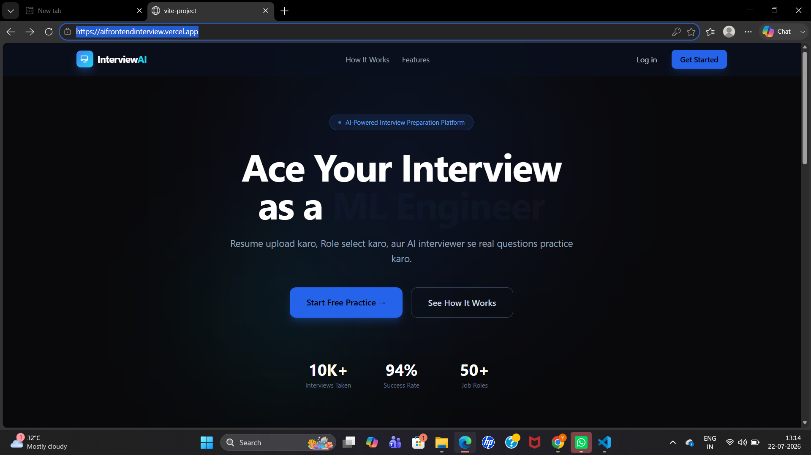
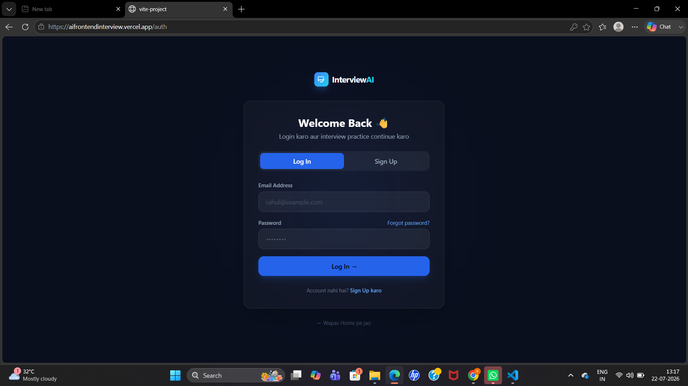
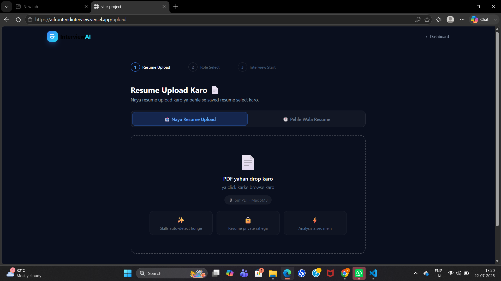
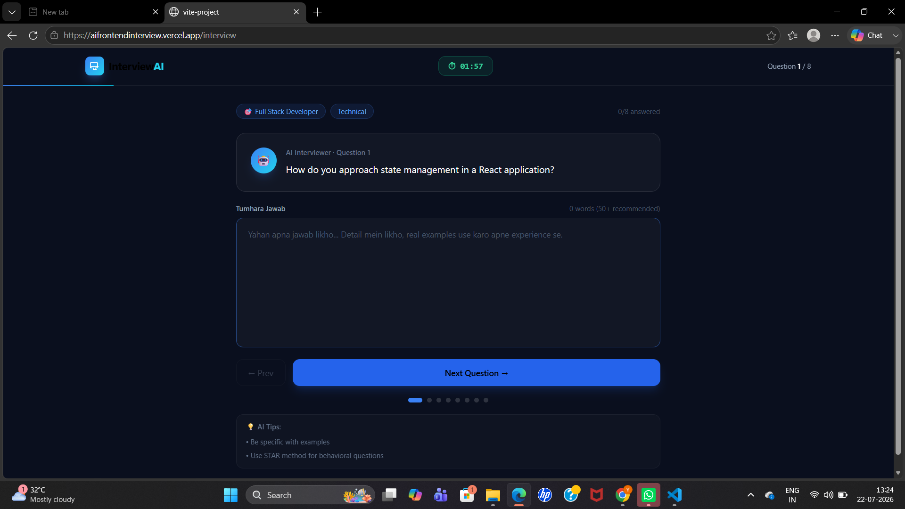
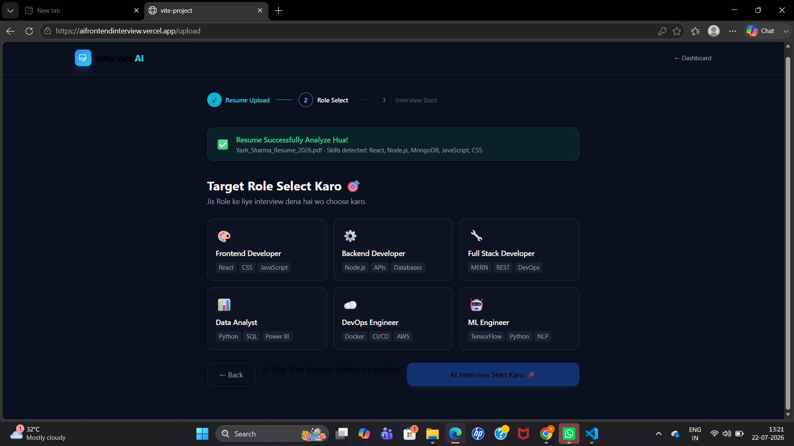

# AI Interview Preparation Platform (Frontend)

A modern AI-powered interview preparation platform built using React and Vite. Users can upload resumes, generate personalized interview questions using AI, practice interviews, and receive instant feedback.

## Live Demo

https://aifrontendinterview.vercel.app/

---

## Features

- Resume Upload
- AI Generated Interview Questions
- Multiple Interview Roles
- Difficulty Selection
- JWT Authentication
- Google OAuth Login
- Interview History
- Responsive UI
- Cloudinary Resume Upload

---

## Tech Stack

- React.js
- Vite
- Tailwind CSS
- React Router
- Axios
- JWT Authentication
- Google OAuth

---

## Backend Repository

https://github.com/yashsharma954/aibackend

---

## Installation

```bash
git clone https://github.com/yourusername/aifrontend.git
```

```
cd aifrontend
```

```bash
npm install
```

```bash
npm run dev
```

---

## 📸 Screenshots

### Home Page



### Login



### Resume Upload



### Interview Screen



### Role Selection




---

## Author

Yash Sharma
